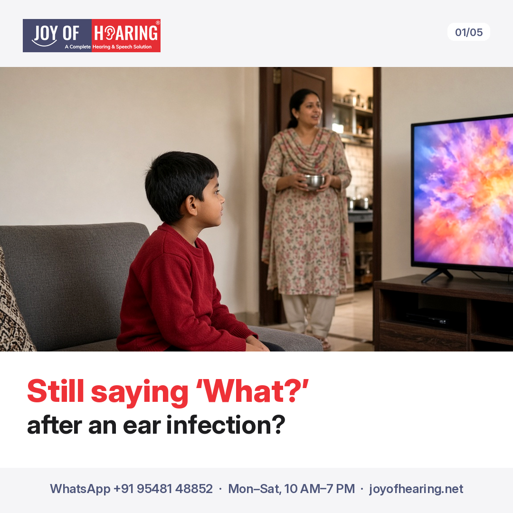
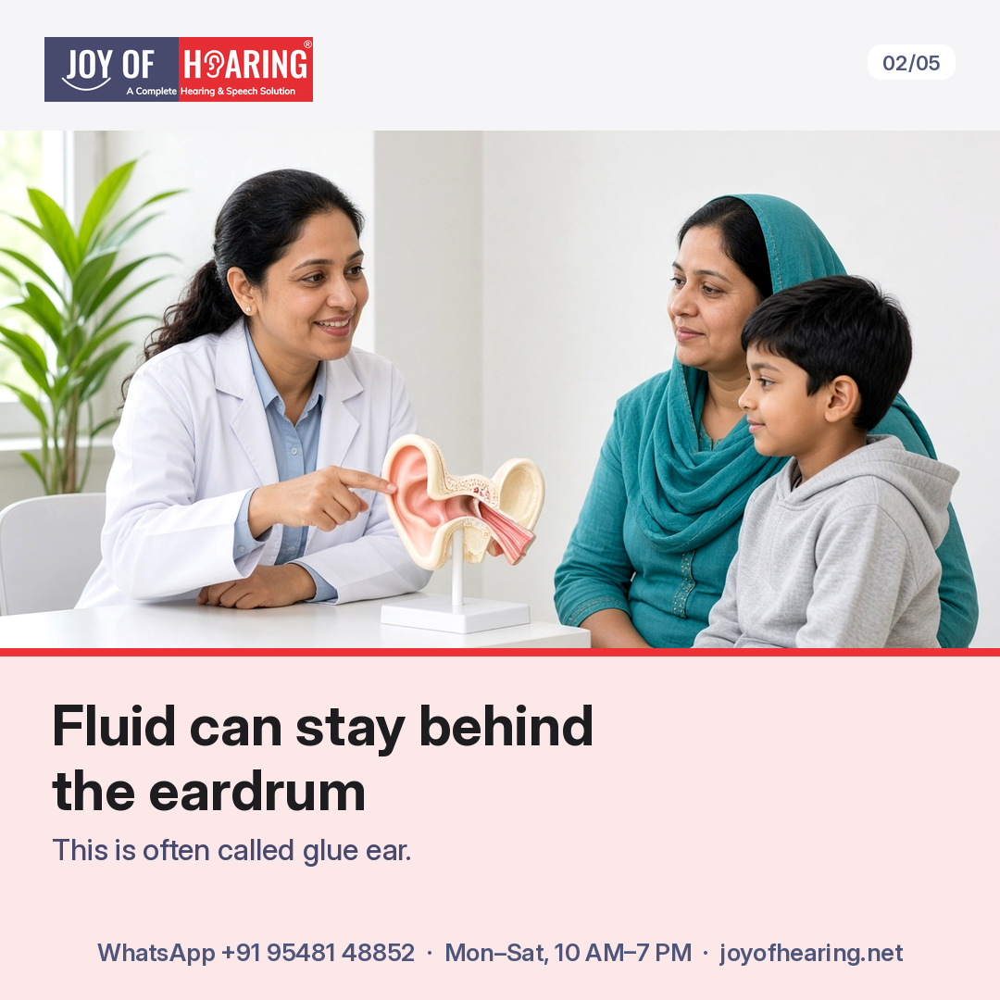
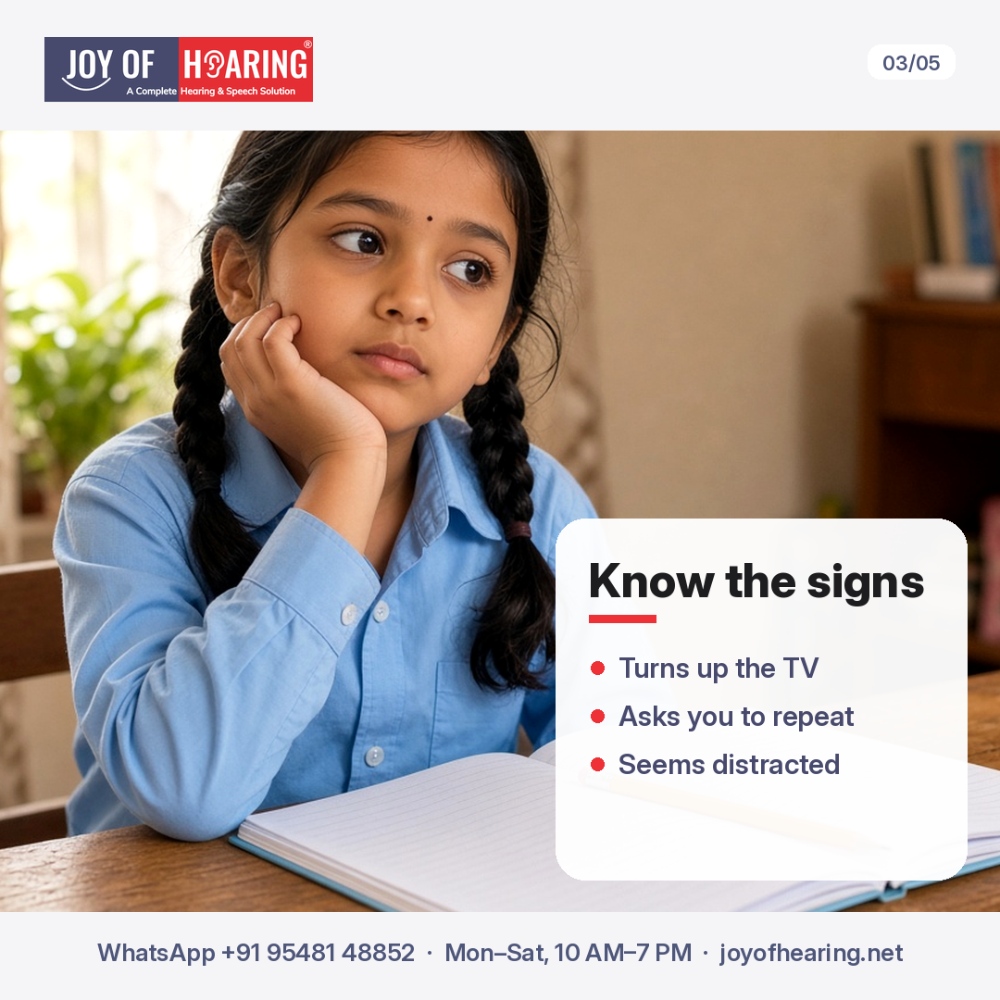
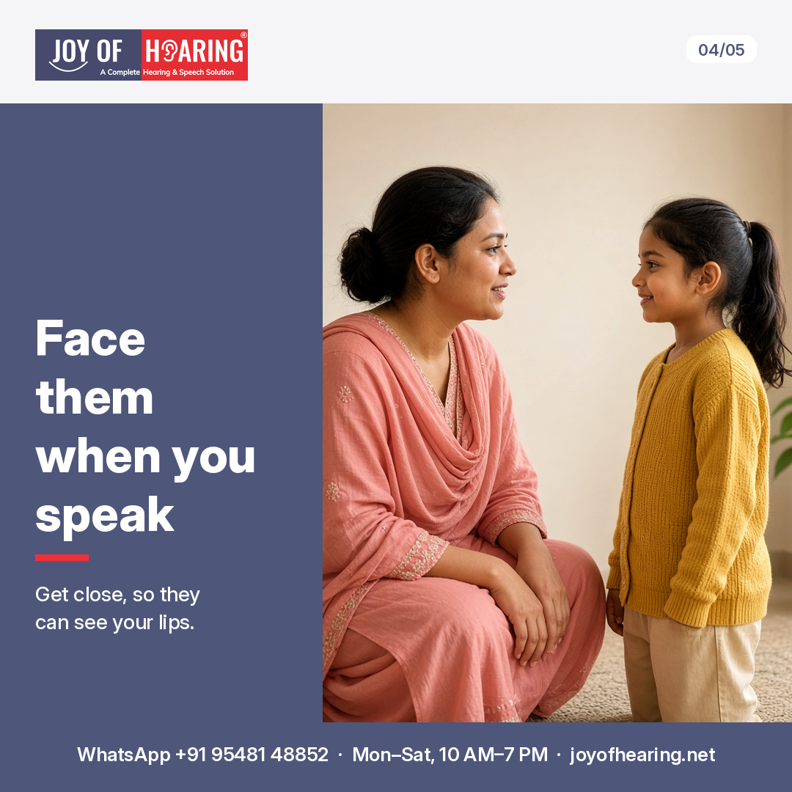
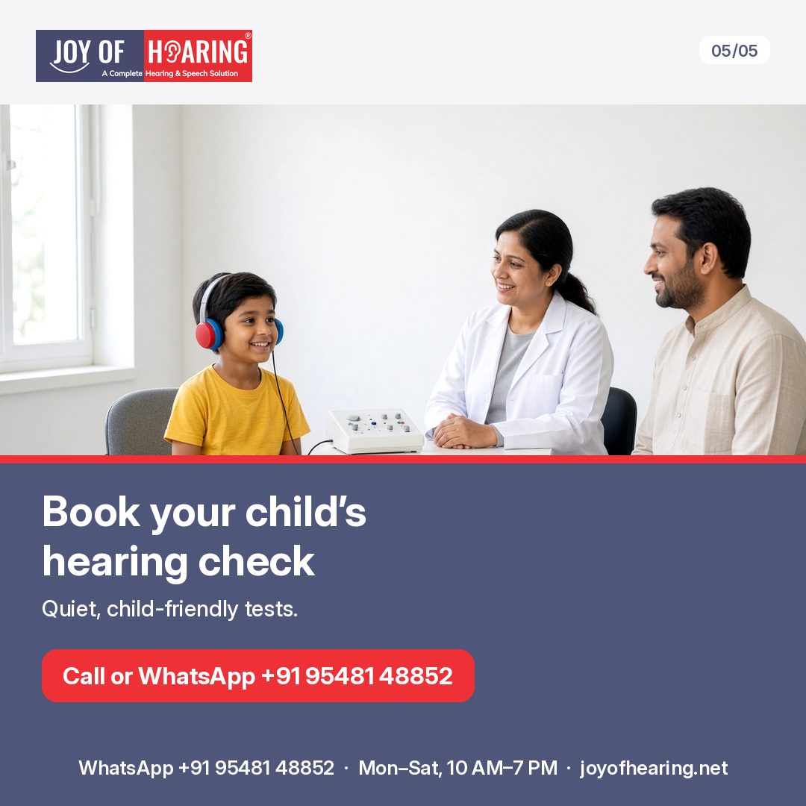

Your child had an ear infection a few weeks ago. The pain went away, the fever settled, and school started again. But now the TV is louder, and they keep saying "What?" when you call from the kitchen. It is easy to think they are just not listening. Sometimes the ear has not fully cleared.

## Why Hearing Can Stay Low After an Ear Infection

Behind the eardrum is a small, air-filled space called the middle ear. During a cold or an ear infection, it can fill with fluid. The pain usually passes in a few days, but the fluid can stay for weeks. This is often called glue ear: thick fluid that stays behind the eardrum after the infection has gone.

That fluid can stop the eardrum moving freely. Sounds reach your child softer and muffled, a bit like listening underwater. Glue ear is often painless, which is why it is easy to miss. In winter, one cold can follow another, and the ear may not get the chance to clear.

## 1. Signs to Notice at Home and at School

Watch for a child who turns up the TV or phone, asks you to repeat things, or does not answer when called from another room. Younger children may tug at an ear, sleep poorly or seem cranky for no clear reason.

At school, a teacher may say your child seems distracted or tired. Some children speak less clearly than before, or go quiet in a group. None of this means your child is being difficult. They may simply be hearing less.

## 2. How to Help Your Child in the Meantime

Get close and face your child when you speak, so they can see your lips. Turn off the TV or mixer before you talk. Speak clearly, without shouting. Ask the class teacher to seat your child near the front, away from noisy fans or windows.

Do not put oil, home remedies or cotton buds in the ear. If your child has a fever, ear pain, or discharge from the ear, see your doctor promptly for the infection itself.

## 3. When to Book a Hearing Check

Book a hearing check if your child has had several ear infections close together, or if the signs above last for a few weeks after an infection has cleared. Book sooner if you notice their speech slipping or they are falling behind in class. A sudden drop in hearing needs same-day medical care.

A hearing check does not hurt. It shows whether your child is hearing clearly now, and whether to watch and recheck or see an ENT doctor.

## Joy of Hearing: Hearing Checks for Children

Our paediatric hearing assessments use quiet, child-friendly tests, including a gentle check of how well the eardrum moves. We explain the results to you in plain words, in English, Hindi or Punjabi, and tell you what to do next. Joy of Hearing offers children's hearing assessments at 11 branches in Punjab.

Call or WhatsApp us at +91 95481 48852 or visit joyofhearing.net to book your child's hearing assessment today.
