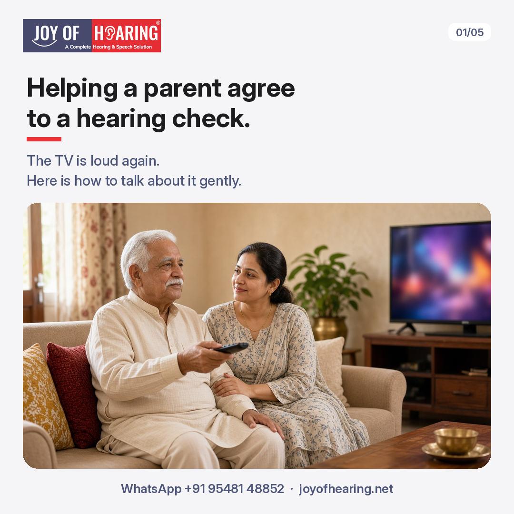
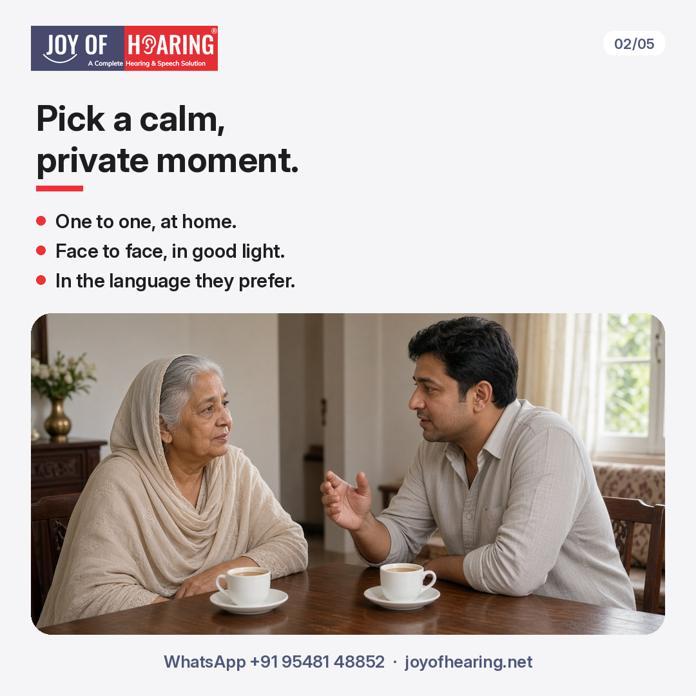
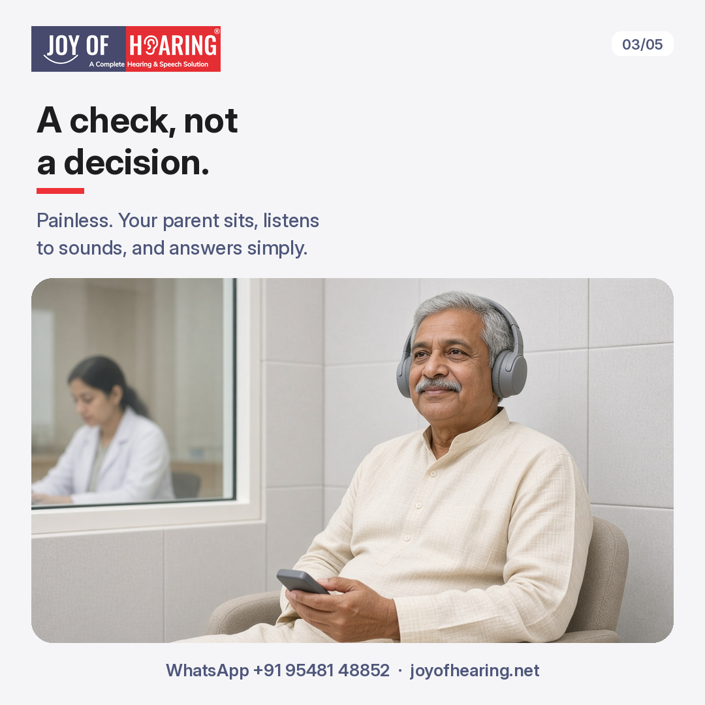
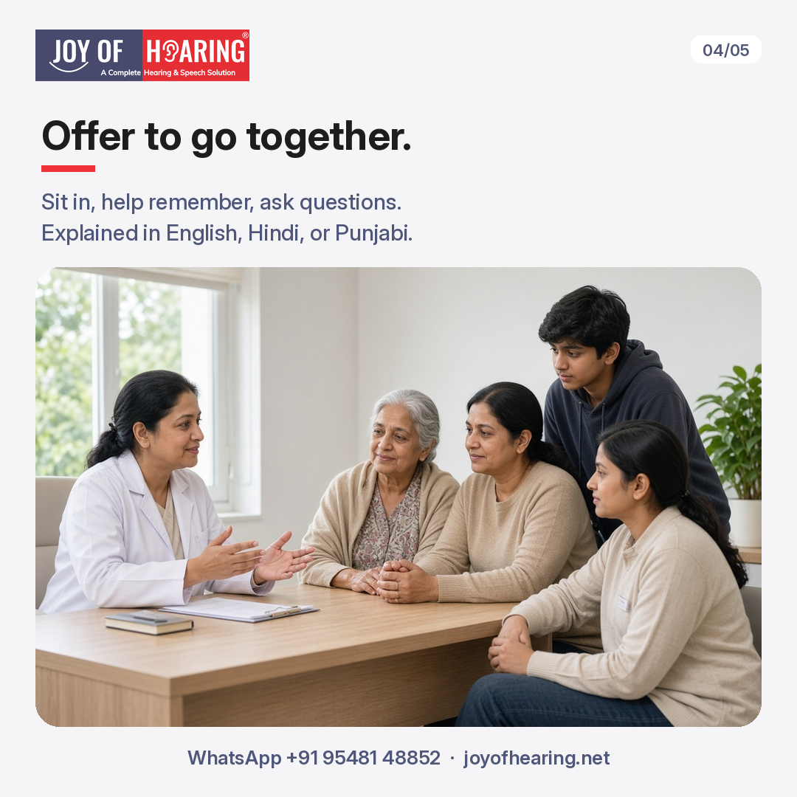
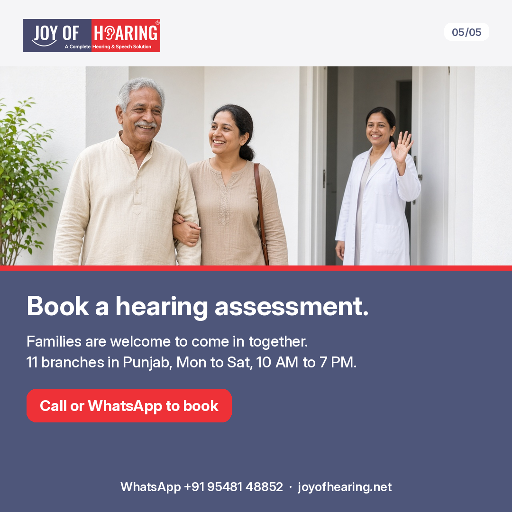

The television is loud again. Your father asks you to repeat yourself twice at dinner, then says everyone mumbles these days. You suggest a hearing test. He waves it away.

You often notice the signs before your parent does. The harder part is the conversation. Here is how to have it gently.

## Why Parents Often Say No

Age-related hearing loss, called presbycusis, usually comes on slowly. Your parent may simply not notice what they are missing. Some worry that a test means they will be told to wear a hearing aid straight away. Others feel it is a sign of getting old, or do not want to be a burden. Knowing the reason behind the "no" helps you choose your words.

## 1. Pick a Calm, Private Moment

Avoid raising it during a family gathering, or just after a misheard conversation when everyone is frustrated. Choose a quiet time at home, one to one. Speak face to face, in good light, in the language your parent is most comfortable with.

## 2. Talk About Moments, Not Problems

"You are going deaf" closes the conversation. "I miss chatting with you on the phone" opens it. Mention specific moments: the grandchildren's stories, the gurdwara or temple katha, a favourite television programme. Keep the focus on staying connected, not on what is wrong.

## 3. Make the Assessment Sound Simple

Explain that a hearing assessment is a check, not a decision. It is painless. Your parent sits in a quiet room, listens to sounds, and answers simple questions. The results show how well each ear hears. Nothing has to be bought, and no one will push a choice on the day.

## 4. Offer to Go Together

Many parents feel easier with a son, daughter, or grandchild beside them. Offer to book the visit, travel with them, and sit in. You can help remember what was said and ask questions afterwards. Our assessments can be explained in English, Hindi, or Punjabi.

## 5. Be Patient, and Know When Not to Wait

It may take more than one conversation. Leave the door open and come back to it in a few weeks. But if your parent has sudden hearing loss in one ear, ear pain, discharge, or dizziness, do not wait for agreement. See an ENT doctor soon.

## Joy of Hearing: Hearing Assessments for Your Parents

Caring for an ageing parent often comes full circle. It asks for the same patience, gentle guidance, and attentive listening they once gave you when you were small. Making sure they do not miss the laughter, stories, and everyday conversations of the family is one of the most meaningful gifts of love you can give. Clearer hearing can bring back their connection to the world and fill their days with comfort and joy.

At Joy of Hearing, families often come in together, and we take time to explain each step to your parent. A hearing assessment gives you both a clear picture, so any next step is a calm, shared choice. We offer hearing assessments at 11 branches in Punjab, Monday to Saturday, 10 AM to 7 PM.

Call or WhatsApp us at +91 95481 48852 or visit joyofhearing.net to book your hearing assessment today.
