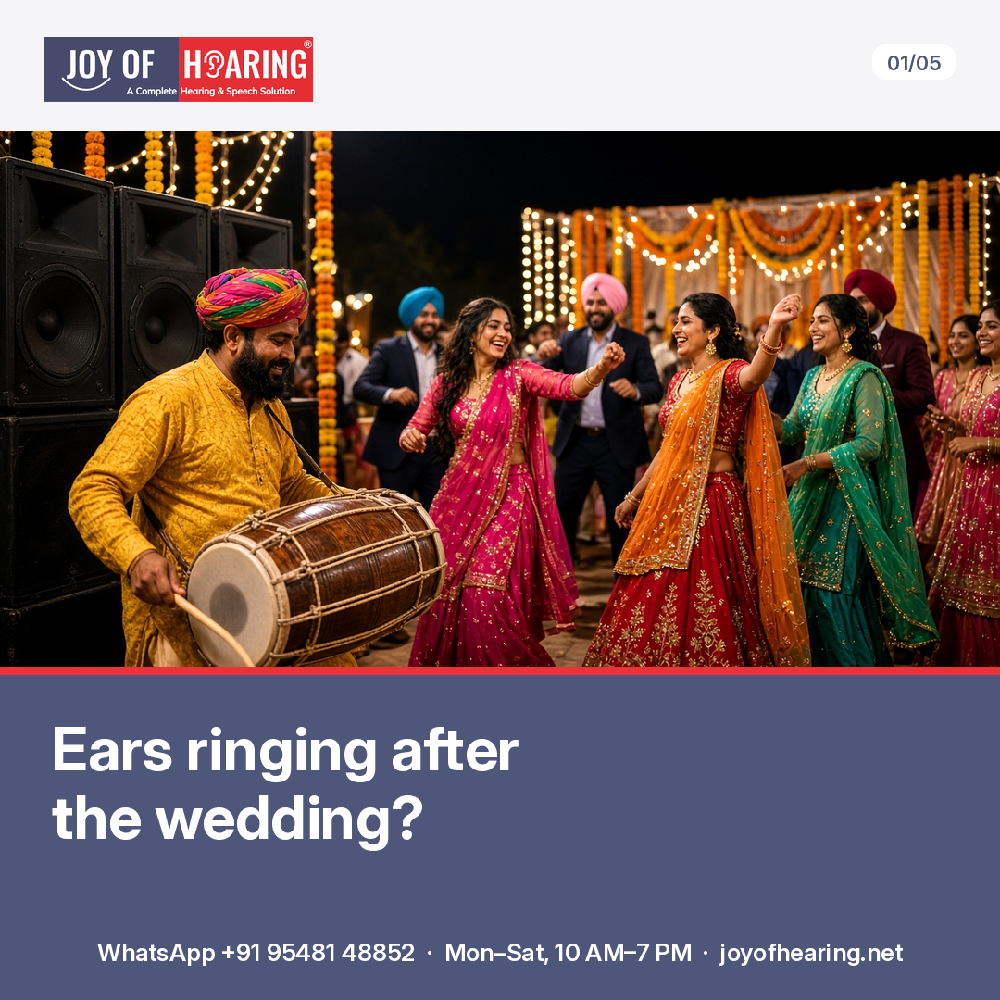
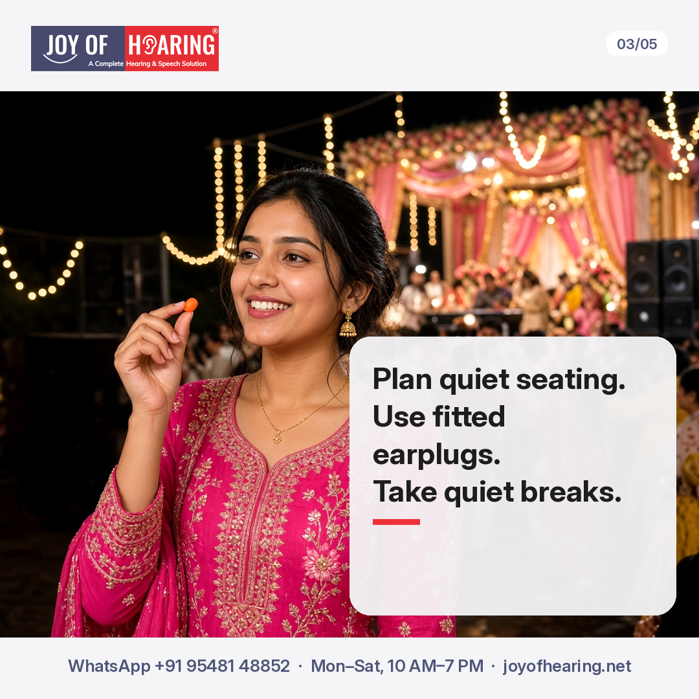
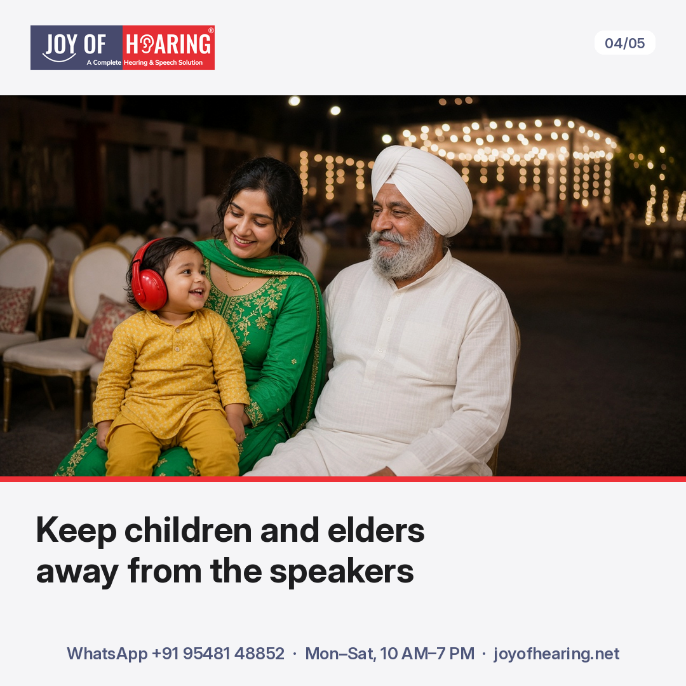
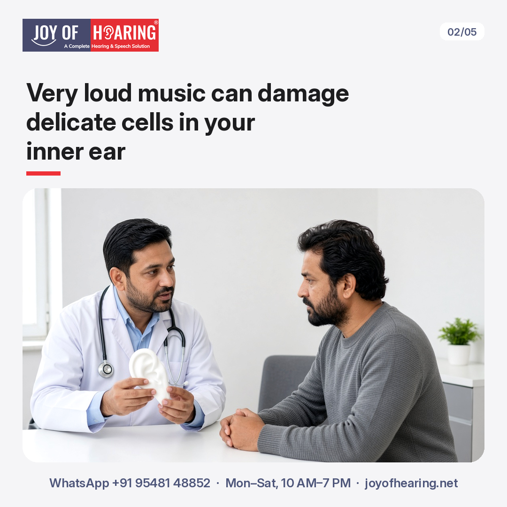
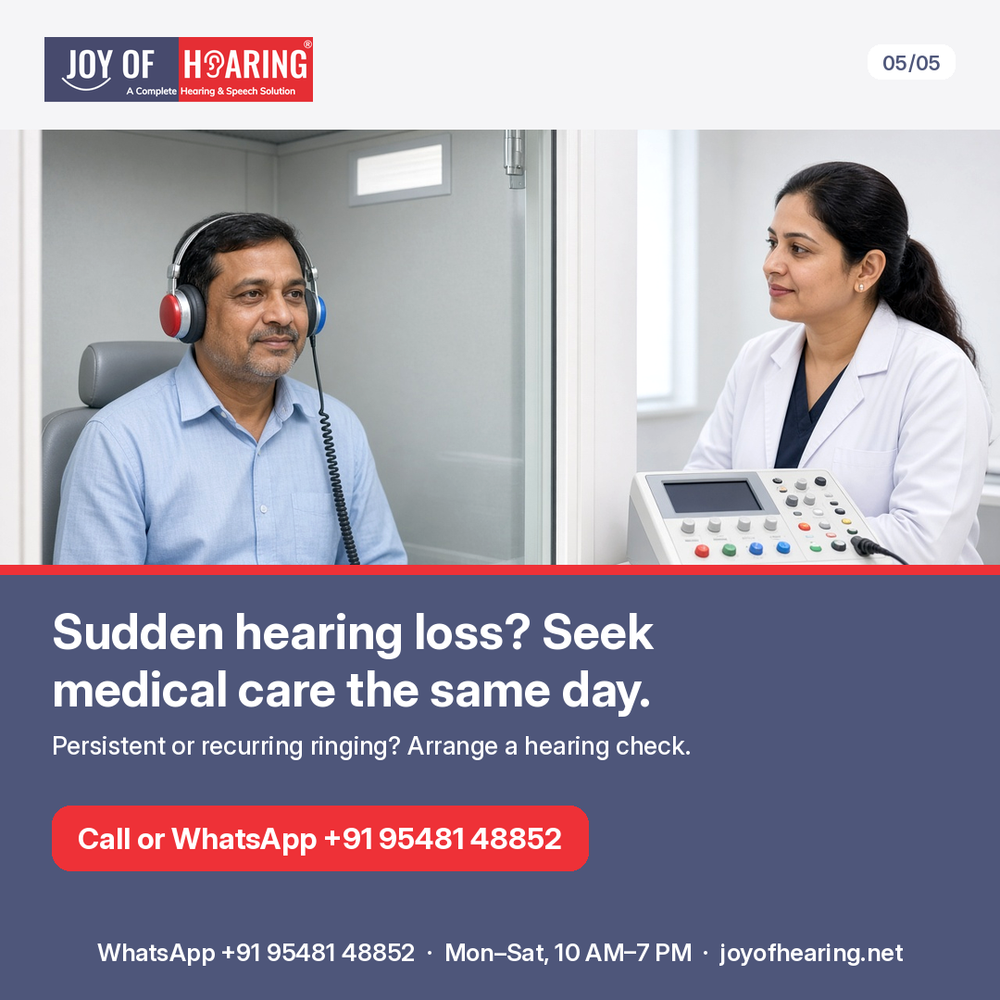

The baraat is dancing, the dhol is pounding, and relatives are gathering near the DJ. You want to enjoy the celebration without going home with ringing ears or muffled hearing. Before the music starts, a little planning with your hosts can help you reduce exposure without missing time with your family.

## 1. Arrange seating away from the DJ and dhol

Ask your host for a table well away from DJ speakers and the dhol, especially for children and relatives who find conversation difficult. Do not assume a place beside the stage is quieter. Walk around before choosing where to sit, and move further away if the sound feels uncomfortable.

Ask the host or DJ to lower the volume. You do not need to wait until your ears hurt to speak up. If conversation means shouting, move somewhere quieter rather than trying to compete with the music.

## 2. Find a quiet room before the music starts

Ask your host where you can take a quiet break before the function gets busy. A separate room away from the speakers may work better than a corner of the same hall. Check that it really is quieter.

Agree which adult will take children there and stay with them. Take regular quiet breaks yourself, and leave sooner if the sound becomes uncomfortable. Breaks do not make very loud exposure safe.

## 3. Choose properly fitted hearing protection

Properly fitted earplugs reduce sound reaching your ears. Foam plugs may muffle speech and music; ask about filtered options and how to fit them correctly before the wedding. Protection does not replace distance or lower volume.

Children may not recognise or explain excessive loudness, so check on them rather than waiting for a complaint. Use age-appropriate, properly fitted hearing-protection earmuffs, and keep children away from speakers and the dhol. Do not rely on earmuffs alone to make a loud setting safe.

## 4. Treat ringing and muffling as warnings

The cochlea, the hearing organ in your inner ear, contains tiny hair cells that turn sound into signals for your brain. Very loud sound can damage these delicate cells. A single very loud event or repeated exposure may cause lasting damage.

Ringing or muffled hearing after a function is a warning, even if it settles. Arrange a hearing check if symptoms persist or recur. Sudden hearing loss in either or both ears needs same-day medical care: do not wait to see if it clears. Ear pain, discharge or dizziness also needs medical advice.

## Joy of Hearing: Hearing Protection for the Wedding Season

Planning for a family wedding? Ask us about hearing protection suited to your needs and how to use it correctly. Joy of Hearing offers hearing protection at 11 branches in Punjab. A hearing protection consultation can help you prepare questions about fit, comfort and different options before the celebrations begin.

Call or WhatsApp us at +91 95481 48852 or visit joyofhearing.net to book your hearing protection consultation today.
