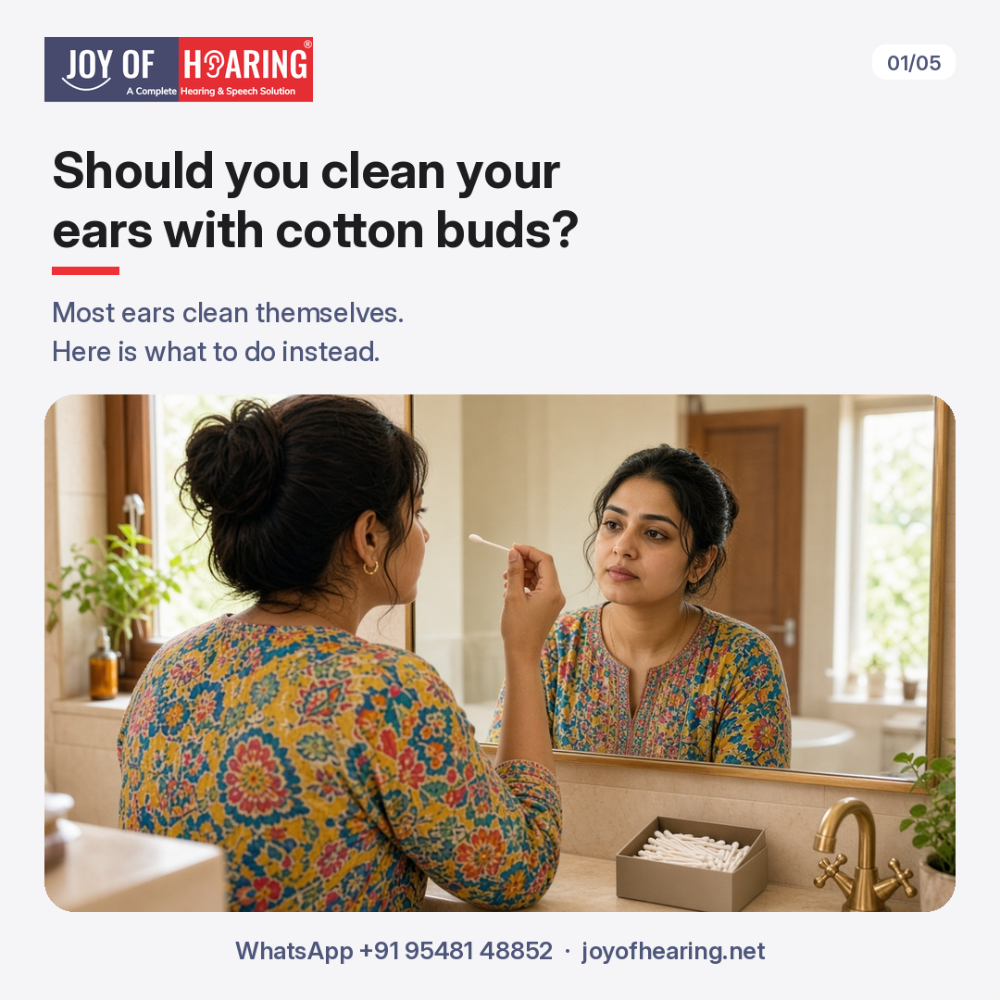
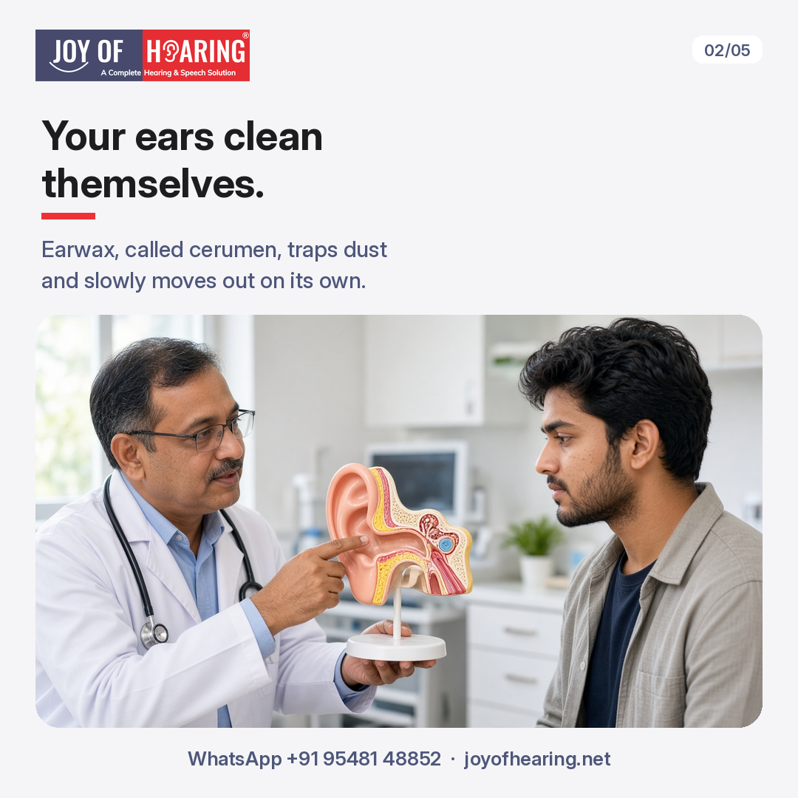
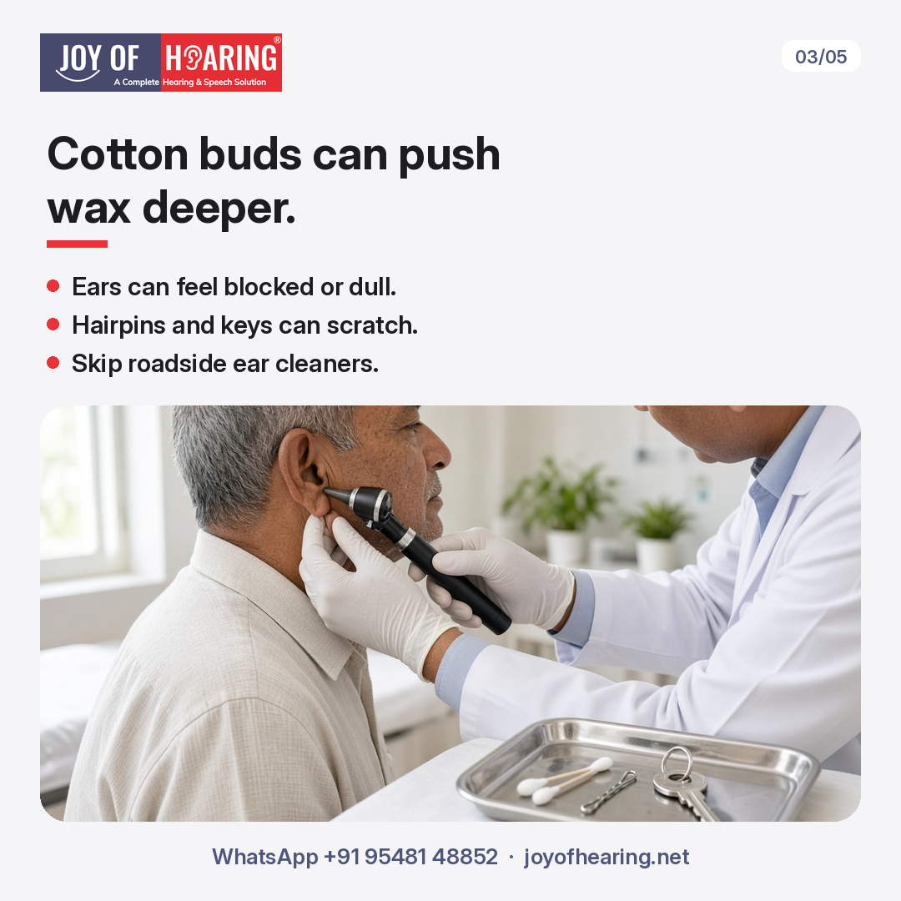
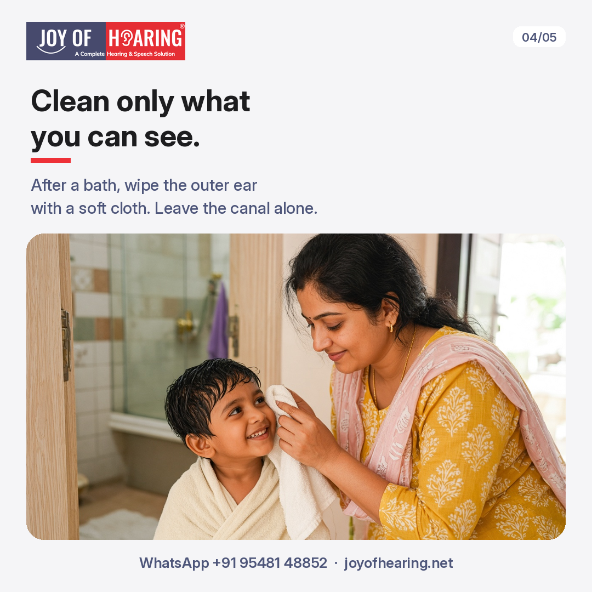
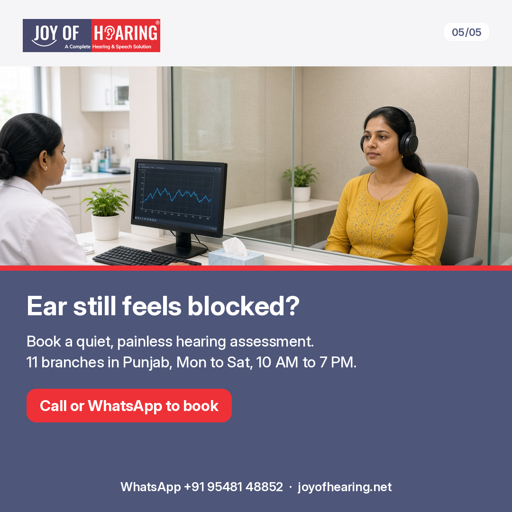

You step out of your bath and reach for a cotton bud. A quick twist in each ear feels clean and sensible. Or a man at the bazaar, with a small tin of tools, offers to clean your ears on the spot.

Most ears do not need this help at all. In fact, it can cause the very problem you are trying to avoid. Here is what is really going on, and what to do instead.

## Why Your Ears Clean Themselves

Earwax, called cerumen, is not dirt. Your ear canal makes it to trap dust, keep the skin moist, and help keep germs out. The skin of the canal slowly carries the wax outwards, helped by the movement of your jaw as you talk and chew. Near the opening, it dries and falls away on its own. For most people, this happens quietly every day, without any help.

## Why Cotton Buds Can Make Things Worse

A cotton bud lifts a little wax from the opening, but it pushes much of the rest deeper. Over time, that wax can pack down inside the canal and leave your ear feeling blocked or dull. The skin inside is thin and easy to scratch, which can lead to itching or infection. Hairpins, keys, matchsticks, and the tools used by roadside ear cleaners carry the same risks, and can damage the eardrum. Ear candles and home remedies poured into the ear are best avoided too.

## 1. Wipe Only What You Can See

After a bath, wipe the outer ear with a soft, damp cloth or the corner of a towel. Stop at the opening. Leave the canal alone. The same rule applies to children.

If you wear hearing aids, clean them the way you were shown at your fitting, and mention any wax build-up at your check-ups.

## 2. Let Water Drain on Its Own

If water gets in, tilt your head to one side and let it drain. Then dry the outer ear gently. Avoid pushing anything in to soak it up.

## 3. Book a Check if Your Ear Stays Blocked

Some people simply make more wax, and it can build up. Book a check if your ear feels blocked for more than a few days, or sounds seem muffled. Do not try to dig it out yourself.

See an ENT doctor soon if you have ear pain, discharge, bleeding, dizziness, or sudden hearing loss in one ear. These need medical care, not cleaning at home.

## Joy of Hearing: Hearing Assessments When Your Ears Feel Blocked

A blocked, muffled feeling is not always wax. Sometimes it is a change in your hearing that has crept up slowly. A hearing assessment is a quiet, painless check that shows how well each ear hears. If anything needs medical attention, we will tell you clearly and suggest the right next step.

We explain every step in English, Hindi, or Punjabi, and family members are welcome to come along. Hearing assessments are available at our 11 branches in Punjab, Monday to Saturday, 10 AM to 7 PM.

Call or WhatsApp us at +91 95481 48852 or visit joyofhearing.net to book your hearing assessment today.
