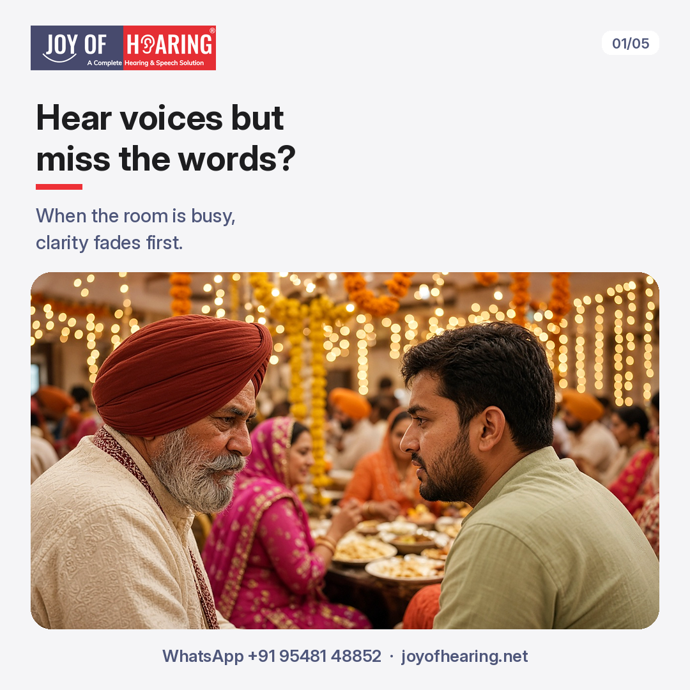
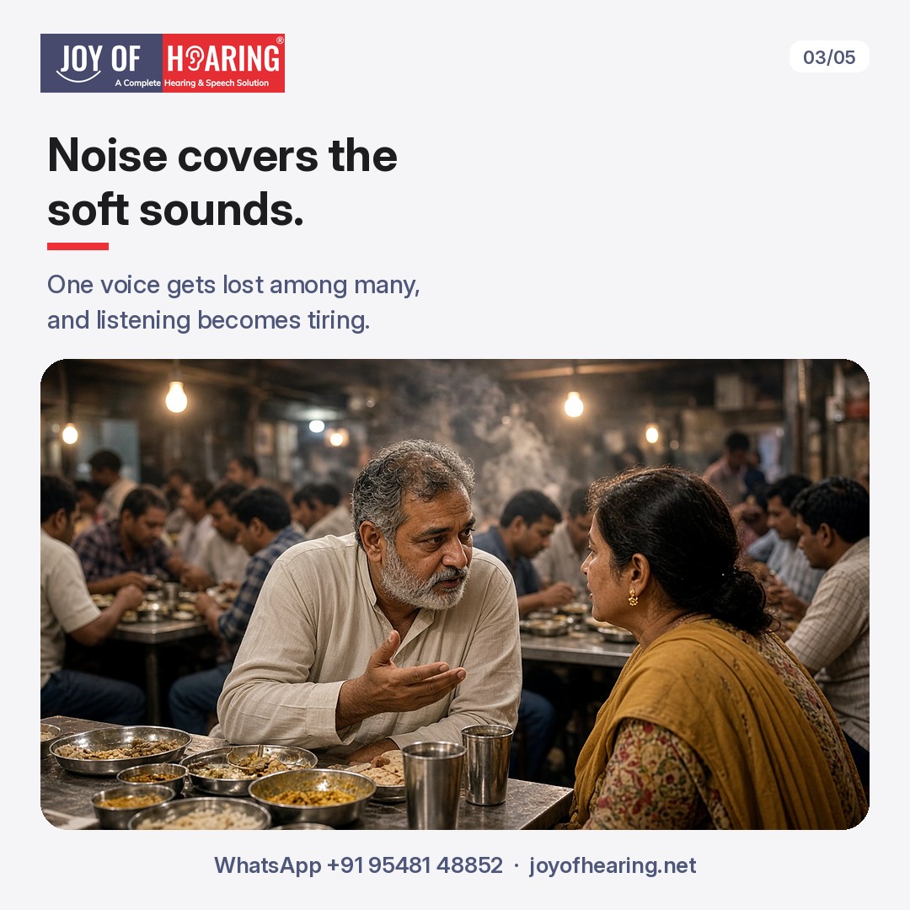
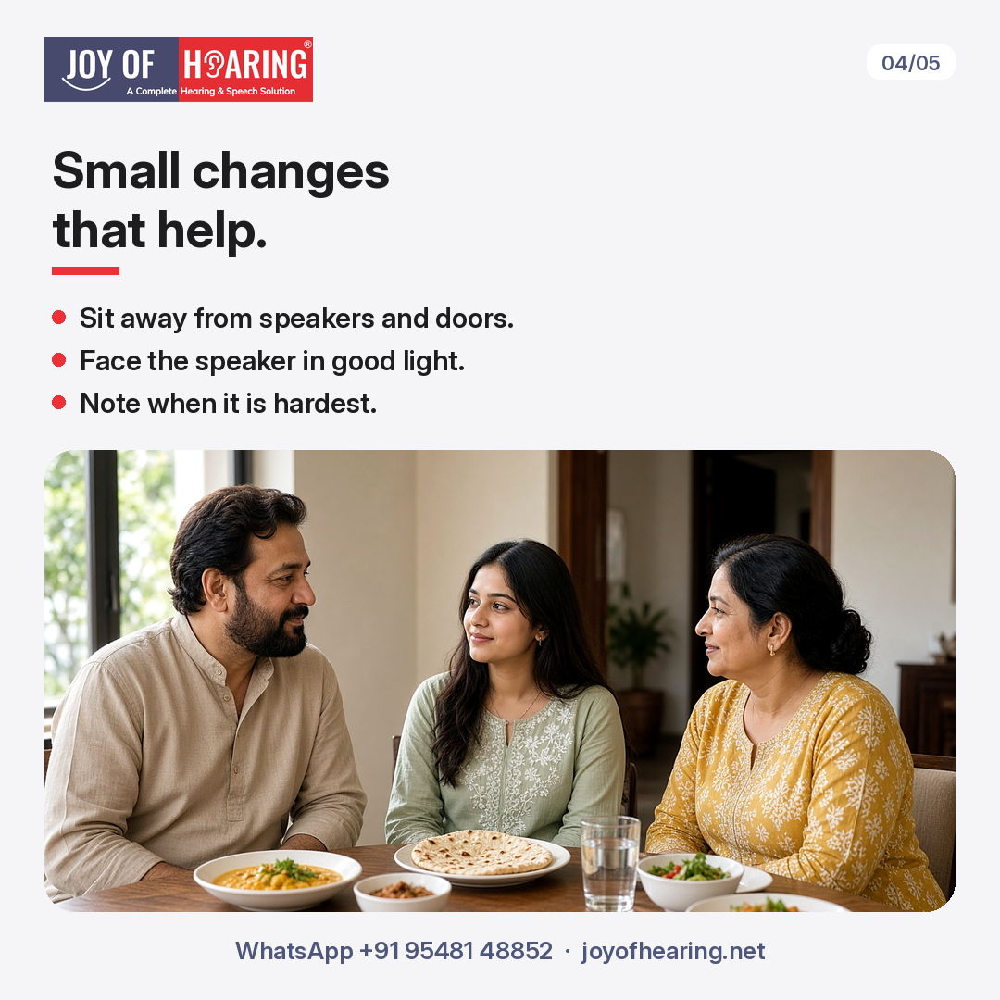
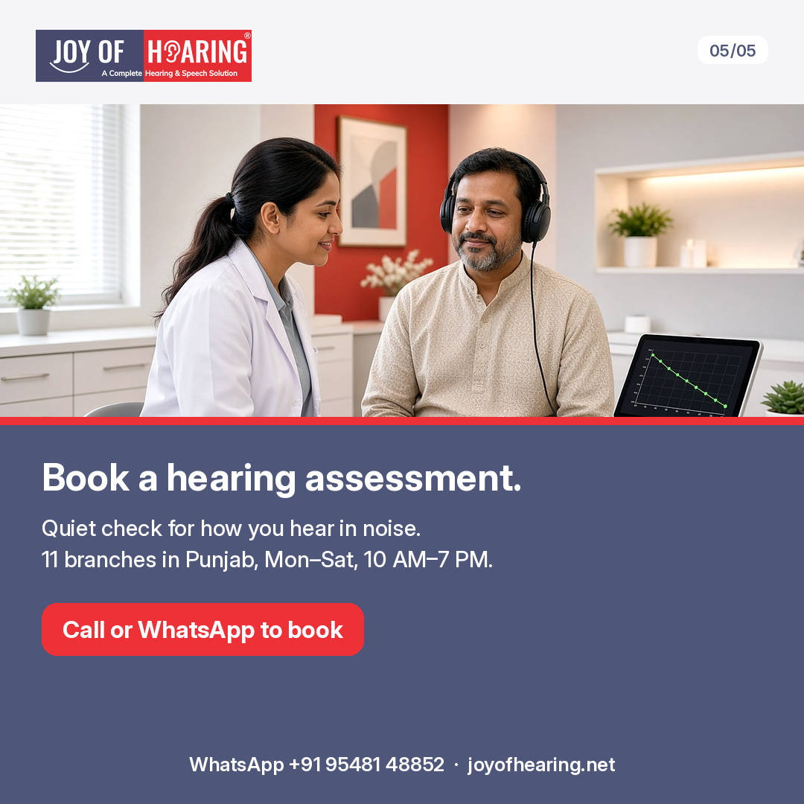

You are at a family wedding. The dhol is playing, plates are clattering, and your cousin is telling you a story. You can hear her voice. You just cannot make out the words, so you nod and smile.

Many people put this down to tiredness, or decide that everyone mumbles now. Often it is neither. It can be one of the first signs of a change in your hearing, and it is worth understanding.

## Hearing Is Not the Same as Understanding

Loudness and clarity are two different things. Vowel sounds, like "a" and "o", carry most of the loudness in speech. Consonants, like "s", "f", "t", and "sh", carry most of the meaning. They are softer and higher in pitch.

When hearing starts to change, those high, soft sounds are often the first to fade. Voices still seem loud enough, but words like "sit" and "fit" begin to sound alike.

## Why Noise Makes It Harder

In a quiet room, your brain fills small gaps from context. In a busy room, background sound covers the same soft consonants you are already missing. Your brain works harder to pick one voice out of many, and that effort is tiring. This is why some people leave gatherings with a headache, or quietly start avoiding them.

A mild high-frequency hearing loss, meaning a loss mainly in the higher pitches, can go unnoticed at home for years and only show up in places like these.

## 1. Choose Your Spot

At a wedding, restaurant, or langar hall, sit away from speakers, kitchens, and doors. Keep a wall behind you, so less noise reaches you from every side.

## 2. Watch the Speaker's Face

Lip movements and expressions fill in a lot. Face the person you are talking with, and make sure their face is well lit. Ask family members to get your attention before they start speaking.

## 3. Notice the Pattern

Keep a simple note for a few weeks. Do you ask people to repeat themselves? Do you turn the TV up louder than others like? Are phone calls harder in one ear? Is it worse in the evening? These details are useful at your appointment.

See an ENT doctor soon if you notice sudden hearing loss, ear pain, discharge, or dizziness.

## Joy of Hearing: A Hearing Assessment for Noisy Places

A hearing assessment is a quiet, painless check that shows how well each ear hears different pitches. We also talk through the places you find hardest, so the advice fits your daily life. If hearing aids would help, we will explain your options clearly. If they would not, we will tell you that too.

We explain every step in English, Hindi, or Punjabi, and a family member is welcome to come along. Hearing assessments are available at our 11 branches in Punjab, Monday to Saturday, 10 AM to 7 PM.

Call or WhatsApp us at +91 95481 48852 or visit joyofhearing.net to book your hearing assessment today.
